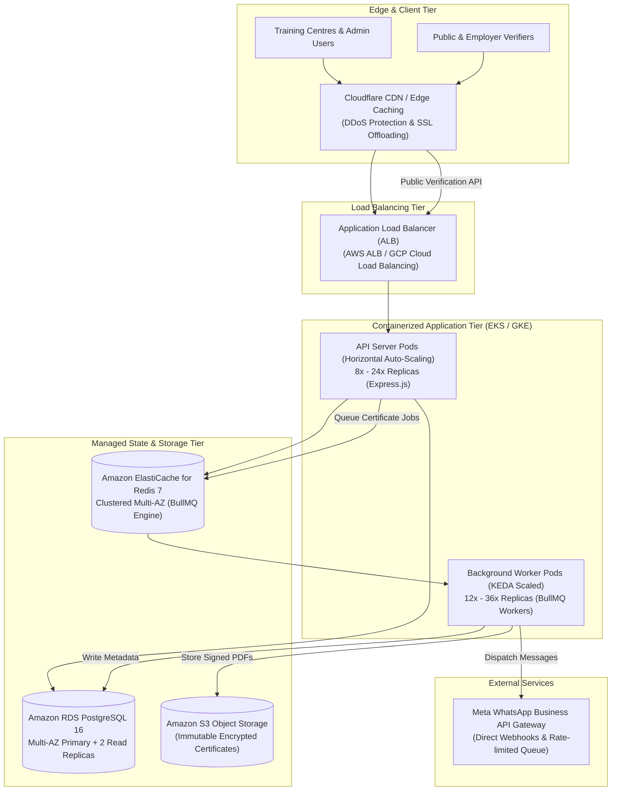

# CertiFlow – Production Deployment Plan
## Scaling Strategy for 100,000+ Registered Users & High-Throughput Credentialing

---

## 1. Workload Sizing & Capacity Targets

This document outlines a production deployment architecture designed to handle:
- **100,000 Registered Users** across training centres, district administrations, state authorities, and employers.
- **10,000 Daily Active Users (DAU)**.
- **Peak Approval Throughput:** 500 batches approved per hour.
- **Peak Certificate Generation:** ~30,000 PDFs generated per hour (~8.3 PDFs/second continuous, bursting up to 25 PDFs/second).
- **Peak Notification Dispatch:** ~30,000 WhatsApp notifications dispatched per hour.
- **Public Verification Lookups:** Tens of thousands of lookups per day with unpredictable traffic spikes following certificate distribution.

---

## 2. High-Level Architecture Diagram

---

## 3. Infrastructure & Component Hosting Choices

| Component | Recommended Production Provider | Instance / Configuration | Justification |
| :--- | :--- | :--- | :--- |
| **Frontend** | Cloudflare Pages / AWS CloudFront + S3 | Global Edge Network | Instant static asset distribution, zero server maintenance, sub-20ms edge latency worldwide. |
| **Backend API** | AWS EKS or GCP GKE (Kubernetes) | `c6i.xlarge` (4 vCPU, 8 GB RAM) | Compute-optimized nodes with fast networking for REST requests and WebSocket connections. |
| **Worker Process** | AWS EKS with KEDA Auto-scaler | `c6i.2xlarge` (8 vCPU, 16 GB RAM) | CPU-intensive PDF rendering benefits from dedicated multi-core compute decoupled from API servers. |
| **Database** | Amazon RDS PostgreSQL 16 | `db.r6g.2xlarge` (8 vCPU, 64 GB RAM) | Memory-optimized for large working sets, Multi-AZ automated failover, NVMe SSD storage. |
| **Redis Broker** | Amazon ElastiCache for Redis 7 | `cache.r6g.xlarge` (Multi-AZ with replica) | In-memory BullMQ throughput, sub-millisecond job acknowledgment, automated failover. |
| **Certificate Storage** | Amazon S3 / Google Cloud Storage | S3 Standard with Glacier Lifecycle | High durability (99.999999999%), signed URLs for private downloads, infinite elastic scaling. |

---

## 4. Worker Scaling & Peak Workload Handling

### 4.1 The 30,000 PDFs/Hour Challenge
Generating 30,000 PDFs per hour requires sustaining **8.33 PDFs per second**. With PDFKit and QR generation taking approximately **150ms per certificate**, a single vCPU core can produce ~6.6 PDFs/second.
- **Baseline Worker Capacity:** 4 pods $\times$ 4 worker threads = 16 parallel workers $\approx$ **100 PDFs/second** theoretical ceiling.
- **KEDA Autoscaling (Kubernetes Event-driven Autoscaling):**
  - Monitors BullMQ queue depth (`certificateQueue`).
  - When queue length exceeds 500 jobs, KEDA automatically scales worker pods from 6 up to 24 pods in under 45 seconds.
  - As backlog drains to zero, worker pool scales down gracefully to preserve compute costs.

### 4.2 Handling 30,000 WhatsApp Dispatches/Hour
Meta's WhatsApp Business API enforces rate limits on messaging throughput (typically Tier 3 / Tier 4 limits: 100 to 500 messages/sec).
- **Rate-Limited BullMQ Worker:** Configured with `limiter: { max: 100, duration: 1000 }` to ensure dispatches never breach Meta's API gateway rate limits.
- **Deduplication:** The `idempotencyKey` pattern (`notif-cert-{certId}`) guarantees candidates never receive duplicate WhatsApp alerts during retries or worker restarts.

---

## 5. Resilience & Outage Recovery Strategies

### 5.1 Worker Crash Recovery
- BullMQ locks active jobs using Redis leases with heartbeat renewals.
- If a worker node crashes mid-generation, BullMQ detects lock expiry within 30 seconds, returns the job to `waiting`, and assigns it to another healthy worker.
- Because `generateCertificatePdf` checks for file existence before writing, retried jobs resume safely without file corruption.

### 5.2 Redis Restart Recovery
- ElastiCache Redis is configured in **Multi-AZ with Automated Failover**.
- Redis persistence is configured with **AOF (Append Only File) every second** and RDB snapshots.
- If the primary Redis node fails, the standby replica is promoted in under 15 seconds without losing queue state.

### 5.3 WhatsApp Provider Outage Handling
- If the messaging gateway encounters an outage (503 Service Unavailable or timeouts), the BullMQ notification worker triggers exponential backoff:
  $$T_{\text{retry}} = 2^{\text{attempt}} \times 2000\text{ ms} + \text{jitter}$$
- Jobs are retried up to 5 times over an expanding window (up to 4 hours).
- Persistent failures are moved to the Dead Letter Queue (DLQ) and flagged on the State Office dashboard for manual re-triggering once gateway recovery is confirmed.

### 5.4 Database Query Congestion
- **Read Replicas:** Read-heavy endpoints (e.g. Public Verification and Certificate Searches) query Amazon RDS Read Replicas, leaving the Primary instance dedicated to transactional state transitions.
- **Connection Pooling:** PgBouncer connection pooler limits open server connections to 200, preventing connection starvation under sudden traffic bursts.

---

## 6. Certificate Storage & Access Security

1. **Storage Decoupling:** PDFs are written to Amazon S3 rather than PostgreSQL BLOB columns, preventing database bloat and vacuum degradation.
2. **Pre-Signed URL Generation:** Instead of streaming binary bytes through the Node.js API, authenticated download requests generate a temporary Amazon S3 Pre-Signed URL with a **5-minute expiration window**.
3. **Immutability:** S3 Object Lock (Write Once, Read Many / WORM) enabled for issued certificates to guarantee documents cannot be altered or overwritten even by administrative credentials.

---

## 7. Monitoring, Logging & Alerting

- **APM & Metrics:** Datadog or Prometheus + Grafana tracking:
  - API HTTP Request Latency ($p95 < 80\text{ms}$, $p99 < 200\text{ms}$).
  - BullMQ Queue Backlog & Processing Rate.
  - Database Connection Pool Saturation & Replication Lag.
- **Centralized Logging:** Winston/Morgan JSON logs streamed to AWS CloudWatch / ElasticSearch with PII masking (phones and emails scrubbed from log lines).
- **Alerting Rules (PagerDuty / OpsGenie):**
  - Alert if BullMQ queue depth $> 2,000$ for $> 5$ minutes.
  - Alert if WhatsApp failure rate $> 5\%$ over a 10-minute window.
  - Alert if Delayed Batches $> 10$ cohorts.

---

## 8. Rough Monthly Cost Estimates (AWS Cloud)

| Resource | Specification | Estimated Monthly Cost (USD) |
| :--- | :--- | :--- |
| **AWS EKS Cluster** | Management Fee + 6x `c6i.xlarge` EC2 Nodes | \$1,150 |
| **Amazon RDS PostgreSQL** | `db.r6g.2xlarge` Multi-AZ Primary + 1 Read Replica | \$1,680 |
| **Amazon ElastiCache Redis** | `cache.r6g.xlarge` Multi-AZ Cluster | \$480 |
| **Amazon S3 Storage** | 5 TB Storage + Data Transfer Out | \$140 |
| **Cloudflare Enterprise / Pro** | CDN, DDoS Protection, SSL Offload | \$200 |
| **Meta WhatsApp API** | Marketing/Utility Conversation Messages | Based on volume (~$0.005/msg) |
| **Monitoring (Datadog / Logs)** | APM, Infrastructure, Log Ingestion | \$350 |
| **Total Estimated Infrastructure Cost** | — | **~\$4,000 / month** |

---

## 9. Architectural Trade-offs

1. **BullMQ + Redis vs. AWS SQS / SNS:**
   - *Trade-off:* Redis requires active memory management and clustering, whereas SQS is fully serverless.
   - *Decision:* BullMQ provides sub-millisecond job scheduling, native job progress tracking, fine-grained rate limiters, and atomic priority queues that are significantly easier to test locally and orchestrate in containerized environments.
2. **Pre-rendered PDFs vs. On-the-Fly Generation:**
   - *Trade-off:* Pre-rendering 30,000 PDFs consumes storage and compute upfront.
   - *Decision:* Pre-rendering guarantees that subsequent public verifications and candidate downloads are instantaneous ($<50\text{ms}$) and ensures the certificate represents an immutable, permanently archived legal document.
