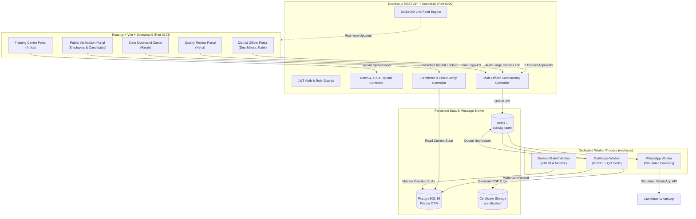

# CertiFlow – Skilling Certificate Issuance Platform
### Centralized Credentialing, Multi-Stage Approval, and Verification Engine for Pragati Skills Mission

[](https://nodejs.org/)
[](https://reactjs.org/)
[](https://www.postgresql.org/)
[](https://redis.io/)
[](https://bullmq.io/)
[]()

CertiFlow is an enterprise-grade, full-stack certificate issuance and lifecycle verification platform built for the fictional **Pragati Skills Mission**. It automates the end-to-end credentialing process for over **300 training centres** and **8,000 monthly candidates**, replacing error-prone spreadsheets, manual reviews, and slow issuance with a secure, auditable, and automated digital workflow.

---

## Architecture Overview



---

## Key Features

1. **Strict Atomic Spreadsheet Ingestion:** Reads Excel files (`.xlsx`, `.xls`) with `xlsx`. If a single row fails validation, the entire transaction is rolled back, saving zero partial records, and reporting the exact Excel row and field.
2. **Dual-Officer District Consensus:** Requires approval by **two independent district officers** before advancing. Built-in concurrency control prevents duplicate sign-offs and double state transitions.
3. **Automated Quality Review Routing:** Batches with $\ge 50$ candidates automatically route to the Quality Review Team (Neha) for deep scrutiny.
4. **Final State Approval & Async BullMQ Queuing:** State Office (Farah) gives final approval, immediately queuing asynchronous background jobs in BullMQ backed by Redis.
5. **Tamper-Evident PDF Generation:** Generates official landscape certificates using `PDFKit` with high-error-correction QR codes, anti-forgery borders, and unique numbers (`CERT-YYYY-XXXXXX`).
6. **Simulated WhatsApp Provider:** Simulates real-world delivery latency, timeouts, exponential backoff retries, and delivery receipts with idempotency keys.
7. **Public Instant Verification Portal:** Zero-login verification portal for employers and the public. Directly queries PostgreSQL in real-time, displaying `VALID`, `REVOKED / CANCELLED`, or `NOT FOUND`. Zero PII (email/phone) is ever leaked.
8. **Permanent Audit Trail:** Every login, spreadsheet upload, district decision, quality review, and certificate cancellation is permanently recorded in the `AuditLog` table.
9. **Delayed Batch SLA Monitoring:** Scheduled background worker detects batches waiting longer than 24 hours and creates escalation alerts.
10. **Live Real-Time Feed:** Socket.IO emits role-scoped live events for real-time dashboard updates without page refreshes.

---

## Demo Credentials & Roles

The system is seeded with six demonstration personas covering all operational roles. Reviewers can easily test each role using the **One-Click Demo Switcher** in the top navigation bar or via standard login.

| Persona | Role | Email | Password | Access Permissions |
| :--- | :--- | :--- | :--- | :--- |
| **Anika Sharma** | `TRAINING_CENTRE` | `anika@pragati.org` | `Password@123` | Create batches, upload spreadsheets, track batches, resubmit returned cohorts |
| **Dev Patel** | `DISTRICT_OFFICER` | `dev@pragati.org` | `Password@123` | District 1 Reviewer; provide 1st or 2nd approval, return, or reject |
| **Meera Nair** | `DISTRICT_OFFICER` | `meera@pragati.org` | `Password@123` | District 2 Reviewer; provides independent second sign-off |
| **Kabir Rao** | `DISTRICT_OFFICER` | `kabir@pragati.org` | `Password@123` | District 3 Reviewer; alternate district officer |
| **Neha Verma** | `QUALITY_TEAM` | `neha@pragati.org` | `Password@123` | Inspects large cohorts ($\ge 50$ candidates), quality sign-off |
| **Farah Khan** | `STATE_OFFICE` | `farah@pragati.org` | `Password@123` | Final approval, revoke certificates, monitor delayed batches, audit logs |

---

## Project Structure

```
certiflow/
├── frontend/                     # React.js + Vite Client Application
│   ├── src/
│   │   ├── api/client.js         # Centralized Axios instance with JWT interceptors
│   │   ├── components/           # Reusable UI components (Navbar, StatusBadge, Modals)
│   │   ├── context/              # React Context (AuthContext, SocketContext)
│   │   ├── layouts/              # DashboardLayout with responsive sidebar
│   │   ├── pages/
│   │   │   ├── auth/             # Login, Unauthorized, NotFound
│   │   │   ├── centre/           # CentreDashboard, CreateBatch, UploadCandidates, BatchList, Details
│   │   │   ├── district/         # DistrictDashboard, PendingBatches, DistrictBatchReview, History
│   │   │   ├── quality/          # QualityDashboard, QualityPendingBatches, QualityBatchDetails
│   │   │   ├── state/            # StateDashboard, PendingFinalApprovals, CertificateManagement, Audit
│   │   │   └── public/           # CertificateVerification, VerificationResult
│   │   ├── routes/               # ProtectedRoute & RoleBasedRoute guards
│   │   ├── styles/custom.css     # Government Technology UI design system
│   │   ├── App.jsx               # Route registry
│   │   └── main.jsx              # Application bootstrap
│   ├── package.json
│   ├── vite.config.js
│   └── Dockerfile
│
├── backend/                      # Node.js + Express.js Backend API
│   ├── config/                   # Database (Prisma), Redis, Constants
│   ├── controllers/              # REST endpoint controllers
│   ├── middleware/               # Authentication and RBAC guards
│   ├── services/                 # PDFKit generator, XLSX parser, WhatsApp simulator, Storage
│   ├── queues/                   # BullMQ Queues (Certificate, Notification, Reminder)
│   ├── workers/                  # BullMQ Workers (CertificateWorker, NotificationWorker, Delayed)
│   ├── events/socket.js          # Socket.IO live update engine
│   ├── utils/                    # Structured Logger, Audit Logger, Certificate Number Sequence
│   ├── prisma/
│   │   ├── schema.prisma         # PostgreSQL schema definition
│   │   └── seed.js               # Database seeder for demo accounts & sample batches
│   ├── certificates/             # Persistent volume for generated PDF certificates
│   ├── uploads/                  # Temporary file upload directory
│   ├── tests/                    # Jest + Supertest comprehensive test suite
│   ├── app.js                    # Express app configuration
│   ├── server.js                 # HTTP server entrypoint
│   ├── worker.js                 # Dedicated background worker entrypoint
│   ├── package.json
│   └── Dockerfile
│
├── docker-compose.yml            # Container orchestration for Postgres, Redis, Backend, Worker, Frontend
├── .env.example                  # Environment variable reference template
├── REQUIREMENTS.md               # Detailed requirements & operational decisions
├── SETUP.md                      # Complete local & Docker installation guide
├── DEPLOYMENT.md                 # 100k-user production scale deployment architecture
└── README.md                     # Master project overview
```

---

## Quick Start with Docker Compose

Ensure Docker Desktop is running on your machine:

```bash
# 1. Clone or navigate to the repository
cd c:\Certiflow

# 2. Copy the environment configuration
cp .env.example .env
cp .env.example backend/.env

# 3. Build and launch all 5 services with a single command
docker-compose up -d --build
```

Access the applications:
- **Frontend Portal:** [http://localhost:5173](http://localhost:5173)
- **Backend API:** [http://localhost:5000/api/health](http://localhost:5000/api/health)
- **Public Certificate Verification:** [http://localhost:5173/verify](http://localhost:5173/verify)

To stop the containers:
```bash
docker-compose down
```

---

## Running the Automated Test Suite

CertiFlow includes an exhaustive automated test suite covering all 8 mandatory scenario requirements from the specification:

```bash
cd backend
npm test
```

### Verified Test Scenarios:
- **TEST 1 – Invalid Spreadsheet Upload:** Validates exact row and column reporting for malformed spreadsheets and verifies **zero partial database persistence** (100% atomic rollback).
- **TEST 2 – Dual District Officers & Simultaneous Approvals:** Verifies that a single officer cannot approve twice in the same cycle and that a cohort advances to state review only upon receiving two distinct officer sign-offs.
- **TEST 3 – Certificate Generation & Uniqueness:** Tests PDF creation, high-correction QR generation, and sequential non-colliding certificate number formatting (`CERT-YYYY-XXXXXX`).
- **TEST 4 – Certificate Revocation & Public Verification:** Revokes a certificate via State Office (Farah) and proves immediate reflection as `CANCELLED` on uncached public verification with zero private information leaked.
- **TEST 5 – Delayed Batch SLA Monitor:** Proves that batches waiting $> 24$ hours without action trigger automated audit alerts and appear in the State Office delayed queue.
- **TEST 6 – Return and Resubmission Cycle Policy:** Proves that returning a batch increments its submission cycle and that previous approvals remain preserved in audit history but do not automatically count toward the new cycle.
- **TEST 7 – Role-Based Authorization:** Proves strict security boundaries (Training Centres cannot approve batches, District Officers cannot cancel certificates, Quality Team cannot give final state approval).
- **TEST 8 – Worker Reliability & Idempotency:** Validates WhatsApp failure simulation, exponential backoff retries, and database idempotency guards.

---

## Step-by-Step Evaluator Walkthrough

1. **Public Verification:** Open [http://localhost:5173/verify](http://localhost:5173/verify). Click the test button for `CERT-2026-000001` to view an active verified certificate, or `CERT-2026-000002` to see an officially revoked certificate with state reason.
2. **Log in as Anika (Training Centre):** Click "Official Sign In" $\to$ One-click demo login for **Anika**.
3. **Create a Batch:** Go to "Create New Batch", name the cohort, and click proceed.
4. **Upload Candidates:** Download the sample CSV template, upload it, and observe the atomic validation. Submit the batch for District Review.
5. **Log in as Dev (District Officer 1):** Use the navbar dropdown to switch to **Dev**. Inspect the pending cohort and record your approval. The badge updates to "1 of 2 Approved".
6. **Log in as Meera (District Officer 2):** Switch to **Meera**. Record the second independent approval. Notice the cohort advances to `QUALITY_REVIEW` (if $\ge 50$) or `STATE_REVIEW`.
7. **Log in as Neha (Quality Review):** If the cohort has $\ge 50$ candidates, inspect the training ratios and approve the quality audit.
8. **Log in as Farah (State Office):** Open "Pending Final Approvals". Click **"Approve & Issue Certs"**.
9. **Watch BullMQ Worker:** The worker generates tamper-evident PDFs, embeds verification QR codes, and sends simulated WhatsApp messages.
10. **Verify & Cancel:** Verify the new certificate on the public portal. Then revoke it as Farah and watch it immediately display `CANCELLED` on subsequent public queries.
